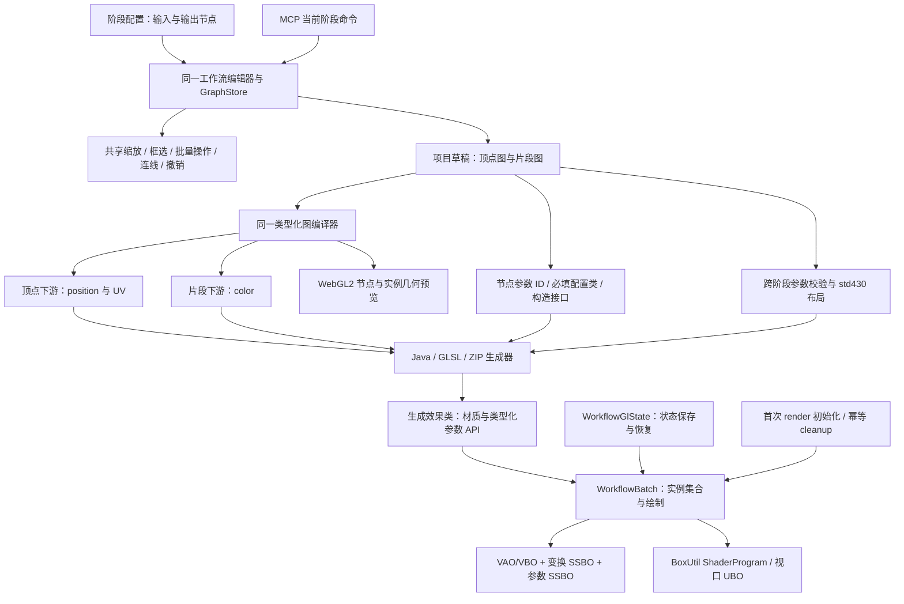

# MengGod Workflow Studio

面向OpenGL shader 的可视化 GLSL 工作流编辑器。用户通过独立节点图构建片段着色器和顶点变形，导出后得到可直接迁移入 Mod 的 Java `CombatLayeredRenderingPlugin`、顶点着色器和片段着色器。

导出的 Java 代码使用 OpenGL 4.3 / GLSL 430、BoxUtil `ShaderProgram` 与 `BUtilGlobalData` UBO。几何使用 VAO/VBO，实例变换和自定义参数使用 SSBO；单实例和批量实例走同一条绘制路径。目标环境为 Starsector 0.98a、BoxUtil 1.6.3、Java 17。

## 功能

- 方形节点画布、贝塞尔连线、框选、拖拽、右键操作、工作流保存与导入。
- GLSL 数学、向量、纹理、噪声、SDF、布尔、If、For、变量与顶点变换节点。
- 自定义 GLSL 节点支持 `in`、`out`、`inout` 参数。
- 节点离屏 GPU 预览；时间节点可仅为预览动画。
- 每个工作流可设置 `64-4096` 的预览画布宽高；GPU 预览按该分辨率渲染，并在方形节点内保持比例。
- 纹理入口在预览中保持比例，运行时在 Java 构造器接收 `SpriteAPI`。
- 导出前校验工作流端口、类型、分支边界、保留 uniform、Java 标识符和可映射的 public uniform 类型。
- 顶点节点图：局部位置、UV、时间、参数、向量组合与拆分、算术、正弦和旋转；包含循环、端口类型和输出校验。
- 输入节点可选择“整批共享／每个实例”，同一参数可用于顶点和片段阶段。
- 顶点页支持多实例几何预览、选中实例参数覆盖、时间播放、图后局部变换和非矩形四边形。
- 本地 MCP 桥接：Agent 可以读取和操作当前页面的未保存草稿。

## 目录

```text
frontend/          浏览器编辑器与 WebGL2 片段预览
frontend/compiler/ 纯片段编译器、类型化顶点图
frontend/export/   参数 ABI、Java/GLSL 生成与 ZIP
frontend/runtime/  唯一 GPU 运行时源码（随导出打包）
ai-gateway/        本地页面服务与 stdio MCP Server
docs/              AI 工作流 JSON 格式
src/workflowshader/ Java 图模型原型及共用新运行时的兼容适配器
build/             导出回归测试
```

## 启动

普通用户不需要安装或启动 Node.js。

1. 从 Releases 下载 Windows x64 ZIP。
2. 将 ZIP 完整解压到任意普通文件夹，不要只把 EXE 单独取出。
3. 双击 `MengGod Workflow Studio.exe`。

桌面应用会自动启动本地编辑器和页面桥接，并自动打开工作流界面。关闭应用后，随 EXE 启动的本地服务也会一同退出。

## 导出产物

点击“导出运行文件”下载一个 ZIP，包含：

- `src/data/scripts/YourPlugin.java`：效果类、类型化参数 setter。
- `src/data/scripts/workflow/WorkflowBatch.java` 与 `WorkflowGlState.java`：共用运行时。
- 所选 shader 目录中的 `YourPlugin.vert`、`YourPlugin.frag`。
- `parameter-layout.json`：参数类型、作用域、16 字节槽位及 SSBO 绑定契约。
- `USAGE.txt`：构造参数与实例调用说明。

将 src/ 内容合并到 Mod 源码目录，data/ 内容合并到 Mod 根目录，再编译 Java。多个效果共用一份 workflow 运行时。1.3 起导出的 Plugin 构造函数接收完整参数配置，自动创建实例；不再使用 1.2 的默认实例构造接口或调用方手动初始化循环。几何来自工作流配置。

在输入节点检查器中定义“参数 ID”、类型、作用域。参数 ID 同时显示在节点卡片上，生成 Java 字段、配置类构造参数及 setter 时保持原名；节点名称可写中文说明，内部连线 ID 和 GLSL uniform 名称独立保留。新输入节点获得独立参数 ID；旧图未设置 parameterId 时取 uniform 去掉 u_ 的名称。同一个 uniform 在两阶段的 ID、类型和作用域必须一致；不同 uniform 不能占用同一个参数 ID。

- 每实例输入自动进入 InstanceParameters；每份配置包含 Transform 和该效果的全部每实例参数。
- 共享输入与纹理自动进入 SharedParameters；没有共享输入时，构造接口自动省略这个类和参数。
- 输入节点增删、改名、改类型或改作用域会同步改变配置类、构造签名、参数布局与使用说明。所有输入均必填；节点默认值只用于编辑器预览。
- 工作流配置窗口中的“Plugin 构造参数”可查看当前完整签名。参数 ID 必须是非关键字的 Java 标识符；实例参数名 transform 为变换配置保留。

内置“实例波动四边形”的入口只需：

```java
InstancedWave effect = new InstancedWave(
    CombatEngineLayers.BELOW_SHIPS_LAYER,
    new InstancedWave.InstanceParameters(
        new InstancedWave.Transform(100f, 100f),
        new Vector4f(1f, 0.3f, 0.1f, 1f), 20f),
    new InstancedWave.InstanceParameters(
        new InstancedWave.Transform(300f, 100f, 45f, 1f, 1f),
        new Vector4f(0.2f, 0.8f, 1f, 1f), 45f)
);
engine.addLayeredRenderingPlugin(effect);
```

上面传了两份配置，因此创建两个实例；传 8 份或长度为 8 的数组，就创建 8 个，空数组创建空批次。实例创建、参数填写、GPU 资源初始化、绘制及清理由生成代码处理，不要求额外写战斗插件。坐标为世界坐标，角度为度。构造配置是快照；需要后续移动时调用 effect.instance(0).setPosition(x,y)，需要更新自定义参数时调用 effect.set_color(effect.instance(0),color)，结束整批调用 effect.markExpired()。

位置、旋转、缩放只应用一次；片段所需实例参数由顶点读 SSBO 并通过 flat 接口传递，UV 正常插值。纹理、共享参数、混合方式和图层在一批内相同；透明效果保持实例插入顺序及批次登记顺序。更新 API 在战斗／渲染线程调用。UINT 在 Java 中使用 int 保存无符号 32 位位模式。

## 顶点与片段共用工作流

顶部两个阶段标签切换同一个编辑器，不重新加载页面。缩放、平移、Shift 框选、批量拖动、复制／剪切／粘贴、删除、撤销／重做、端口拖线、子图和自定义节点都走同一套逻辑；画布视图、选区和撤销栈按阶段分别保存，刷新页面后撤销栈重置。

数学、向量、纹理、噪声、If／For、参数及自定义节点共用。顶点专用入口为“局部顶点坐标”，出口为“顶点输出”的 position / uv；片段出口为“片段输出”的 color。参数可直接在任一阶段声明，导出合并同名声明并校验类型和作用域，实例参数仍由顶点读取 SSBO，再按需传到片段阶段。

“几何设置”保留四顶点、平移、缩放、旋转及多实例预览。顶点图与片段图共同驱动 WebGL2 几何预览；浏览器按实例提交参数，不代表游戏端 SSBO 性能。工作流配置、自定义节点、右键菜单和几何弹窗使用统一深色按钮主题，主操作与删除操作只用颜色区分。

旧版顶点页面地址会转入共享编辑器；1.1 的 op / inputs 顶点图自动迁移，保存为与片段图一致的 nodes / links 格式。

## 实际架构



- GPU 资源只在有效渲染上下文创建。初始化失败、战斗结束及主动过期共用清理路径。
- 变换数据遵守 BoxUtil `Fixed2DStruct` 的 32 字节布局，批次拥有独立 SSBO；不修改 BoxUtil 全局实例池。自定义参数每项占一个 16 字节槽，bool/int/uint 使用整数位模式。
- 只有精确匹配标准四边形时借用 `ShaderCore` 共享 VAO；其他四顶点保留原形状并拥有独立 VAO/VBO。共享几何与视口 UBO 不由效果释放。
- 数据变化时更新实例缓冲；静止批次复用已有数据。绘制后恢复 program、VAO、普通缓冲绑定、SSBO 索引范围、纹理单元、混合及深度状态。
- 为支持任意顶点变形，目前关闭基于 CPU 半径的批次裁剪；未实现 GPU 粒子模拟、跨材质自动合批、任意网格或 WebGL2 SSBO 性能预览。
- Java 图模型原型通过 `WorkflowShaderPlugin` 适配到同一运行时，不再依赖其他 Mod 的私有工具类。架构细节见 [架构说明](src/workflowshader/ARCHITECTURE.md)。

## MCP

桌面 EXE 会自动启动页面桥接，不需要手动运行 `server.mjs`，也不需要安装 Node.js。使用步骤：

1. 启动 `MengGod Workflow Studio.exe` 并打开需要编辑的工作流。
2. 打开“工作流”，点击“激活当前草稿”。
3. 点击“运行 MCP 自检”，确认 EXE 能启动内置的 stdio MCP。
4. 点击“显示 MCP 配置与接入提示”，将页面生成的当前 EXE 路径、MCP 脚本路径和实际桥接端口填写到 Codex、Claude Desktop 等客户端。
5. 新建或重启 Agent 会话，确认工具列表中出现 `workflow_get_status`。

配置由应用根据当前安装位置动态生成，形式如下：

```json
{
  "mcpServers": {
    "workflow-shader": {
      "command": "<MengGod Workflow Studio.exe 的完整路径>",
      "args": ["<应用目录>/resources/ai-gateway/mcp-server.mjs"],
      "env": {
        "ELECTRON_RUN_AS_NODE": "1",
        "WORKFLOW_BRIDGE_URL": "http://127.0.0.1:4174"
      }
    }
  }
}
```

完整 JSON 工作流格式和 Agent 提示见 [docs/AI_WORKFLOW_FORMAT.md](docs/AI_WORKFLOW_FORMAT.md)。

默认桥接地址为 `http://127.0.0.1:4174`；端口被占用时应用会自动选择空闲端口，因此应使用页面实际生成的配置，不要照抄示例端口。MCP 的 stdio 进程由 Codex、Claude Desktop 等客户端按需启动，不会作为 EXE 的常驻子进程。桥接只操作用户明确激活的编辑器页面未保存草稿：页面加载或后台同步不会激活；在目标页面点击画布或“激活当前草稿”即可激活，其他新开页面无法覆盖该草稿。

在 EXE 内点击“工作流 → 运行 MCP 自检”可验证该 EXE 能启动 stdio MCP 并返回 `workflow_*` 工具列表。自检通过不等于 Codex 已加载配置：用户仍需在 Codex 新建会话，并确认能看到 `workflow_get_status`。正常 Agent 工作顺序为 `workflow_get_status`、`workflow_get_summary`、按需读取节点目录、携带 `expectedRevision` 写入、再次读取摘要验证。常规读取不会传输纹理预览 Base64 或生成源码。

## 源码开发（可选）

只有修改源码、使用浏览器调试或自行构建桌面应用时才需要 Node.js 18 或更新版本。源码版页面桥接可这样启动：

```powershell
Set-Location ai-gateway
npm run start
```

然后打开 <http://127.0.0.1:4174/>。开发者构建桌面应用可运行根目录的 `构建桌面应用.bat`。

## 验证

先安装测试依赖：`npm install`。浏览器测试默认使用本机 Edge；也可设置 BROWSER_CHANNEL 为已安装的 Chromium 渠道。测试创建独立浏览器上下文和桥接端口，不修改用户草稿。

```powershell
npm test
npm run test:browser
& .\build\verify-native.ps1 -GameRoot E:\StarSector -JdkHome <JDK17目录>
```

第三步需要本机 OpenGL 4.3，使用 LWJGL Pbuffer 离屏上下文，编译全部生成 Java 与 Java 原型，链接 shader 并检查真实像素及 GL 状态。实际验证结果和游戏内验收步骤见 [验证记录](docs/VALIDATION.md)。

## 状态

1.3.0 根据输入节点生成完整构造参数类，Plugin 在构造时自动创建实例。1.2 的调用代码需要调整为新的配置对象接口；原工作流 JSON 可继续打开。浏览器编辑器为主实现；Java graph/compiler 为兼容原型。更新源码后需要重新构建桌面包，旧 Releases 不会自动更新。
