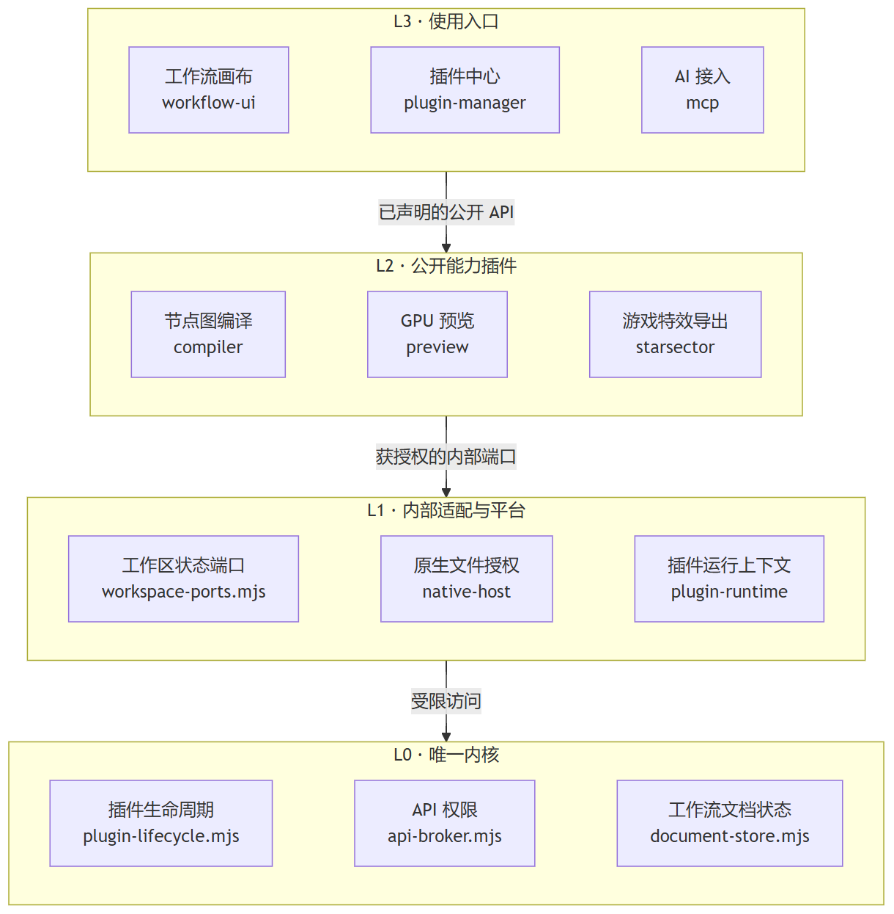

# MengGod Workflow Studio

在节点画布上制作 Starsector 战斗特效，边连线边看 GPU 预览，再把特效放进自己的 Mod。顶点工作流控制几何和位移，片段工作流控制颜色和透明度，两者使用相同的编辑操作。

[下载 Windows x64 桌面版](https://github.com/Eb-Ling/MengGodWorkflowStudio/releases/latest/download/MengGod-Workflow-Studio-1.0.0-win-x64.zip) · [查看发行包与校验文件](https://github.com/Eb-Ling/MengGodWorkflowStudio/releases/latest)

## 做出第一个特效

1. 解压桌面版，运行 `MengGod Workflow Studio.exe`。使用发行包无需安装 Node.js。
2. 打开「工作流」，选择内置示例。切换「顶点工作流」和「片段工作流」，拖入节点，连接类型匹配的端口，再在检查器中调整参数。
3. 右键节点预览可打开独立高清视框，默认长边 2048，最高 4096。画布支持缩放、框选、批量删除和撤销，快捷键可以在「插件 → 插件设置」中修改。
4. 在几何设置选择实例数，决定哪些参数要留给调用方，按需要自定义节点与参数 ID。按 **Ctrl+S** 保存工作流。
5. 点击「导出运行文件」。首次导出时先设置 Mod 中的公共依赖源码路径，例如 `data/method`，导出一次 `WorkflowRuntime.java`。每个特效只有 **一个 Java 文件、一个顶点着色器和一个片段着色器**。

把 Java 编译进 Mod 实际加载的 JAR，将着色器放到导出标明的目录。使用 BoxUtil 并满足 OpenGL 4.3 的渲染要求。在已有战斗入口按生成的构造器传参，再调用 `engine.addLayeredRenderingPlugin(effect)` 登记一次。单个世界坐标用 `Vector2f`，批量用 `List<Vector2f>`。运行依赖设置可随时打开，修改路径后重新导出需要使用新包名的代码。

## 让 AI 使用 MCP

1. 保持 Studio 打开，进入 **插件 → 插件设置 → MCP 工作流接入**。只查看内容选只读，需要改图、保存或导出时选可编辑。
2. 点击 **复制配置说明给 AI**，粘贴到支持 MCP 的客户端，请它完成配置并连接。也可展开「手动配置」。同一用户配置目录会记住授权，正常重启和端口变化无需重新配置。
3. 告诉 AI 工作流或草稿名称。例如：“先读取名为「冲击波」的已保存工作流，给我看一张长边 2048 的预览图，暂时不要修改。”

AI 应先列出目标，按你指定的类型与 ID 选择，读取摘要后再操作，结束后重新读取核对。遇到重名先询问。读取当前草稿可以只读，从保存版本或恢复草稿载入编辑器需要可编辑权限。面板中可自检连接，也可随时撤销外部接入。

## 安装与开发插件

从「插件 → 插件管理 → 添加本地插件」选择目录，审阅声明和权限后登记。没有声明时可以使用向导。若希望 AI 稍后登记，请选择「仅授权，稍后登记」。目录内容或权限改变后需重新审阅。教学插件可以按需启用。

开发扩展可下载 [独立开发包](https://github.com/Eb-Ling/MengGodWorkflowStudio/releases/latest/download/workflow-plugin-devkit-1.0.0.zip)，从最小节点、面板或双阶段特效示例开始。普通特效制作者无需安装开发包。

## 软件如何组织

以制作特效为例，你在 L3 的工作流画布上连接节点，L2 的编译插件把节点图转成着色器，GPU 预览或游戏导出使用这份结果。图中每层只列代表模块，层与层之间的箭头表示允许的接入方向。

- [架构手册](docs/ARCHITECTURE_V1.md)：完整分层图，每个内置插件的文件、依赖、输出接口，以及扩展的注册路径。
- [API 手册](docs/PLUGIN_API_V1.md)：从一个可登记的插件开始，查阅能力、参数、权限、MCP 工具和 Starsector 调用方式。
