# Studio 分层与插件架构

从四层总图了解职责，沿业务图看一次编辑如何变成图像或游戏源码，再按插件名称查看自己的扩展需要哪项能力。接口参数、权限和代码示例集中在 [API 手册](PLUGIN_API_V1.md)。

## 分层总览

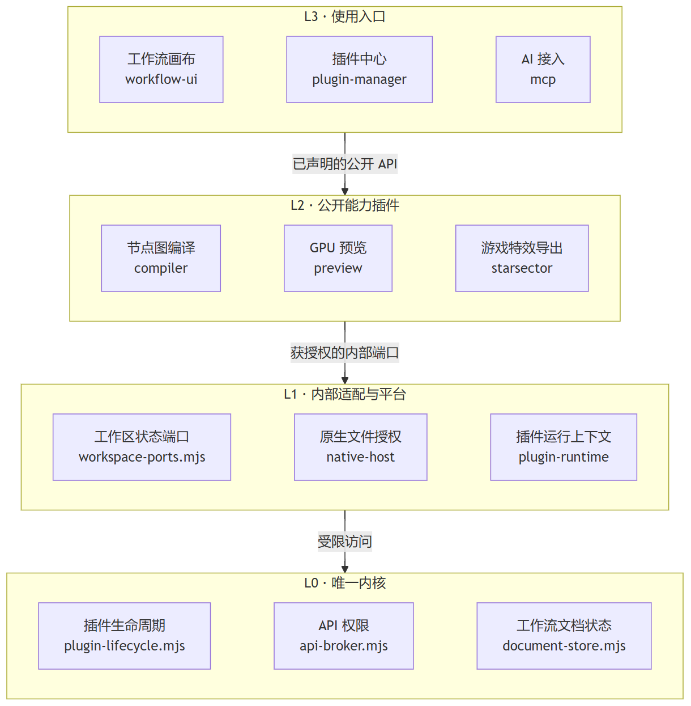

箭头表示允许的接入方向。每层选了三个代表模块，完整的模块分组见下图。[查看简图的 Mermaid 源文件](diagrams/studio-layers.mmd)。

## 模块归属图

这张图表示允许的层级与模块归属，不把源码导入、业务请求、贡献登记混画。L2 中的分组是阅读方式，不增加运行时层级或管理器。插件之间没有实现导入，服务调用必须使用声明过的 API。

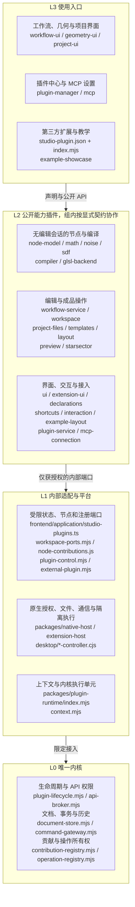

图中短名称均对应 `plugins/<名称>/`。公开契约位于 `packages/plugin-sdk/`，无状态图规则和参数位于 `packages/workflow-tools/`，跨语言 IR 位于 `packages/shader-ir/`。它们不是额外的业务层，也不提供绕过权限的状态入口。`packages/ui-kit/` 只由 UI 提供者装配。

源码依赖由 `build/check-architecture.mjs` 扫描实际导入与 exports。运行时 API 依赖由 `build/check-plugin-graph.mjs` 解析必需和可选声明。两种图分别生成在临时验收目录，不能用概览图代替门禁。

## 业务调用图

这里箭头统一表示调用公开能力。节点贡献、图准备与编译均不依赖当前编辑会话。编译请求自带文档副本，图准备只解析该请求，不查询当前草稿。

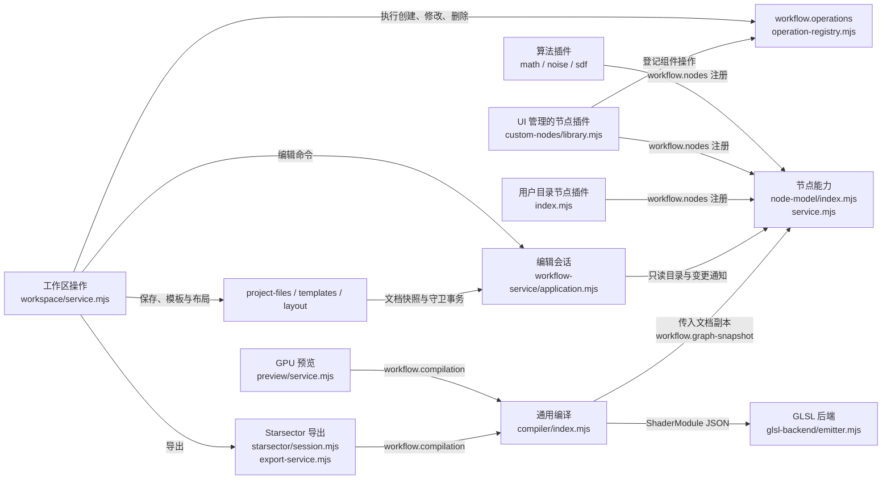

这是计算与编辑主链，完整清单仍包括预览和导出读取当前文档，以及 UI、快捷键等所属能力。Workspace 不依赖 UI、插件管理或 GPU 预览。MCP 连接服务分别调用 Workspace、预览和插件管理，它只做具名请求路由，不把这些能力并成一个业务对象。

`workflow.nodes` 与 `workflow.graph-snapshot` 的提供者为 `studio.node-model`。`workflow.editor`、`workflow.presentation`、`workflow.library` 仍由 `studio.workflow-service` 提供。调用方声明 API 名称，不导入提供者文件，也不需要关心提供者的文件位置。

同步及异步节点规则共用 IR 校验。隔离节点首次编译直接等待结果，相同请求合并。停用或替换后旧结果失效，不通过“正在编译”的失败刷新循环产生预览。缓存身份包含提供者身份与编译输入。

## 跨进程通信与注册

这是运行时消息顺序，不是另一张源码依赖图。隔离侧没有共享内核对象，所有跨进程参数都是有预算和白名单的 JSON。

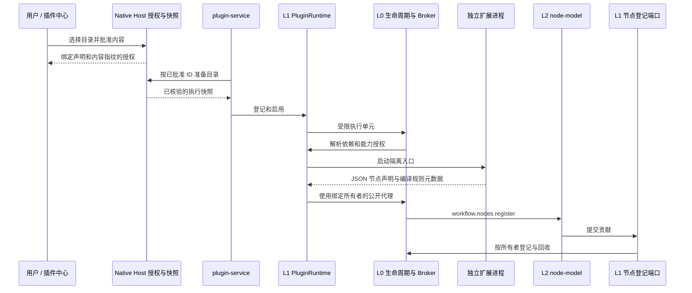

目录授权不执行入口，也不改源码。MCP 只能列出已授权目录并按 ID 登记，不能提交任意路径或自行批准。原生 Host 检查目录范围、真实路径、内容指纹和发送者，SDK 代理检查方法和能力，Broker 检查调用者、实际提供者和生命周期。即使第三方声明相似的权限，也不能取得 `platform.node-registry` 或 `platform.workspace-state`。

L1 状态与登记适配器仅供限定内置能力持有，不能借 Adapter 把 Store、Registry 或管理器透传给扩展。第三方 UI 使用声明式面板或独立隔离窗口，不把任意 Vue 组件装入主渲染进程。受信任内置组件由 `studio.ui` 的作用域 API 挂载。

## 全部插件与主要文件

| 层 | 插件 | 主要文件与职责 |
| --- | --- | --- |
| L3 | workflow-ui | `index.ts`、`WorkspaceControls.vue`、`GraphEditor.vue`、`Inspector.vue`，双阶段画布、工具按钮、检查器和导出状态 |
| L3 | geometry-ui、project-ui | 各 `index.ts` 与 Vue 组件，几何和项目操作界面 |
| L3 | plugin-manager、mcp | `PluginManagerPanel.vue`、`McpSettings.vue`，插件中心和接入配置 |
| L3 | example-showcase | `index.ts`，可停用的扩展教学 |
| L2 | node-model | `index.mjs`、`service.mjs`、`node-catalog.mjs`、`graph-snapshot.mjs`，节点贡献、目录与无会话图准备 |
| L2 | math、noise、sdf | 各 `index.mjs`、`contribution.mjs`，类型化算法贡献，不依赖编辑器 |
| L2 | compiler、glsl-backend | `compiler/index.mjs`、`lower.mjs`、`cache.mjs`，`glsl-backend/emitter.mjs`，受检快照转 IR，再发射目标源码 |
| L2 | workflow-service | `application.mjs`、`service.mjs`、`document-policy.mjs`、`presentation.mjs`，编辑会话和原子文档操作 |
| L2 | workspace | `service.mjs`，保存、模板、布局及导出的完整动作，状态返回数据，不读写 DOM |
| L2 | project-files、templates、layout | 各 `service.mjs`，文件绑定与恢复、子图模板、布局 |
| L2 | preview | `service.mjs`、`controller.mjs`、`renderer.mjs`，GPU 生命周期、普通与高清图片 |
| L2 | starsector | `session.mjs`、`export-service.mjs`、`runtime/WorkflowRuntime.java`，目标校验、单入口三文件和公共依赖 |
| L2 | ui、extension-ui | `ui/service.ts`、`workspace-registry.ts`，`extension-ui/service.mjs`，组件与声明面板作用域 |
| L2 | shortcuts、interaction、declarations | 各 `index` 和服务文件，快捷键、画布策略和无脚本动作解释 |
| L2 | plugin-service | `management.mjs`、`coordination.mjs`，登记、授权和状态持久化编排，不另建生命周期 |
| L2 | mcp-connection | `session.ts`、`editor-client.mjs`，按所选草稿派发具名操作，自动重连 |
| L2 | example-layout | `index.mjs`，可单独消费的布局 API 教学 |

`frontend/application/studio-plugins.ts`、`ai-gateway/server.mjs`、`desktop/main.cjs` 是组合根。三处分别负责渲染器装配、原生状态配置、内置源码目录，门禁核对清单一致。外部目录插件不需要改这三处。

<!-- manifest-reference -->

## 按插件阅读

每张图只展开一个插件。框内文件间的实线指向静态导入的同插件实现。标记“必需”和“可选”的边指向它消费的能力，可选依赖使用虚线。标记“提供”的边列出其对外 API。清单、类型导入、动态回调和资源不画成文件导入边。没有对外 API 的插件通过登记视图、命令或节点产生效果。

### 工作流编译前端 · studio.compiler

目录：[compiler/manifest.mjs](../plugins/compiler/manifest.mjs)。实现：[cache.mjs](../plugins/compiler/cache.mjs)、[index.mjs](../plugins/compiler/index.mjs)、[lower.mjs](../plugins/compiler/lower.mjs)、[preview.mjs](../plugins/compiler/preview.mjs)。

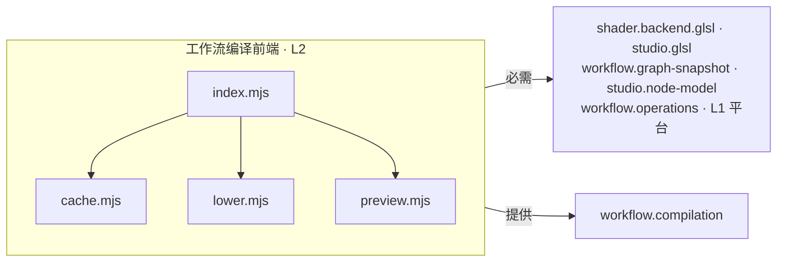

### 自定义 GLSL 节点 · custom.glsl

目录：[custom-nodes/manifest.mjs](../plugins/custom-nodes/manifest.mjs)。实现：[index.mjs](../plugins/custom-nodes/index.mjs)、[library.mjs](../plugins/custom-nodes/library.mjs)、[seeds.mjs](../plugins/custom-nodes/seeds.mjs)。

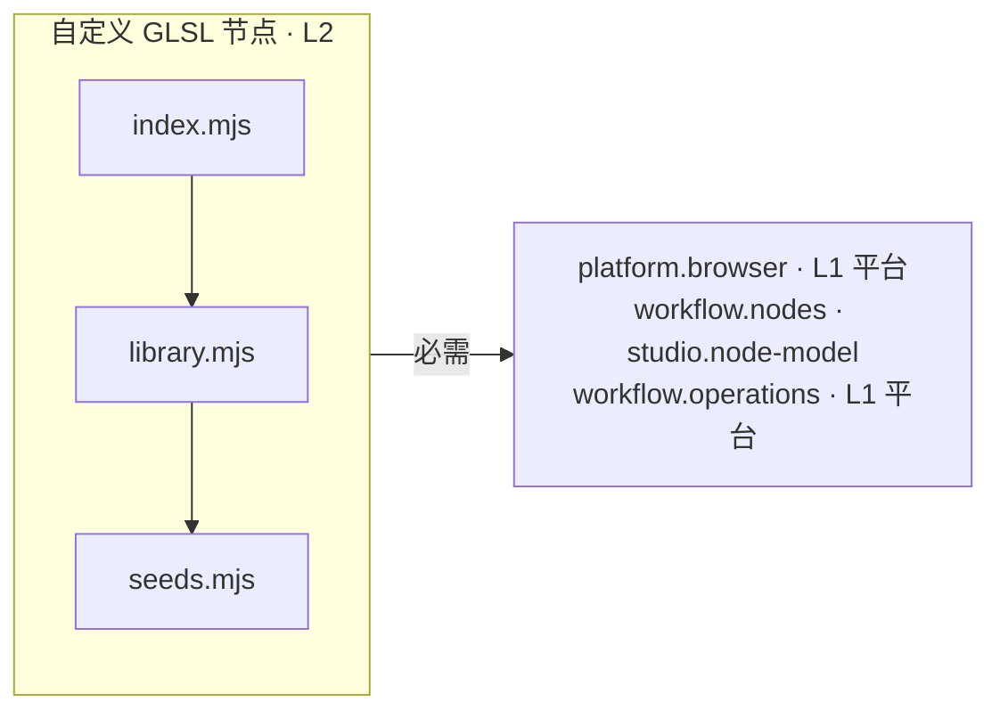

### 无脚本声明式插件 · studio.declarations

目录：[declarations/manifest.mjs](../plugins/declarations/manifest.mjs)。实现：[index.mjs](../plugins/declarations/index.mjs)、[planner.mjs](../plugins/declarations/planner.mjs)、[session.mjs](../plugins/declarations/session.mjs)。

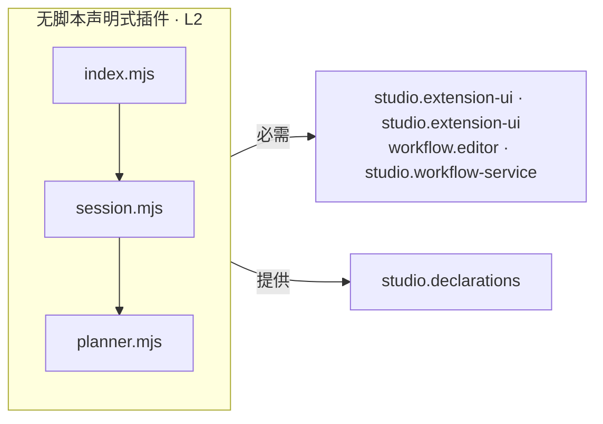

### 示例：布局 API 提供者 · example.layout

目录：[example-layout/manifest.mjs](../plugins/example-layout/manifest.mjs)。实现：[index.mjs](../plugins/example-layout/index.mjs)。

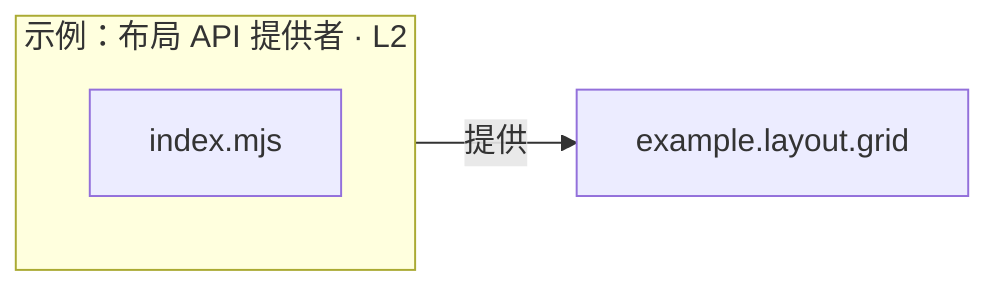

### 示例：双阶段事务与节点 · example.showcase

目录：[example-showcase/manifest.mjs](../plugins/example-showcase/manifest.mjs)。实现：[CanvasExtension.vue](../plugins/example-showcase/CanvasExtension.vue)、[ShowcasePanel.vue](../plugins/example-showcase/ShowcasePanel.vue)、[TintCard.vue](../plugins/example-showcase/TintCard.vue)、[TintField.vue](../plugins/example-showcase/TintField.vue)、[index.ts](../plugins/example-showcase/index.ts)、[tint-node.mjs](../plugins/example-showcase/tint-node.mjs)。

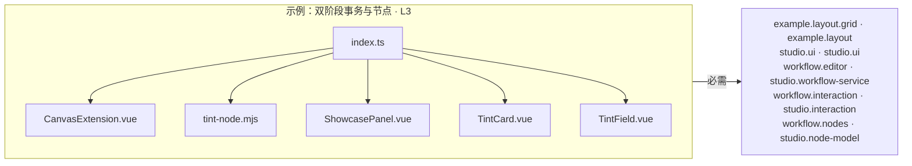

### 隔离插件面板 · studio.extension-ui

目录：[extension-ui/manifest.mjs](../plugins/extension-ui/manifest.mjs)。实现：[ExtensionPanel.vue](../plugins/extension-ui/ExtensionPanel.vue)、[ExtensionSettings.vue](../plugins/extension-ui/ExtensionSettings.vue)、[index.ts](../plugins/extension-ui/index.ts)、[service.mjs](../plugins/extension-ui/service.mjs)。

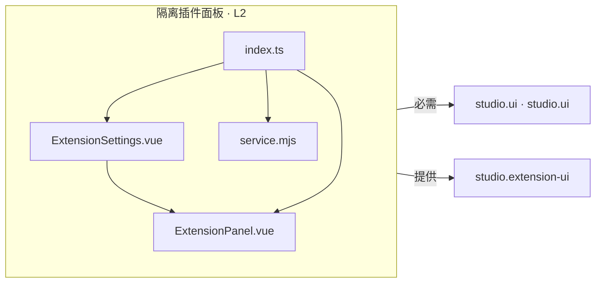

### 几何参数与实例预览面板 · studio.geometry-ui

目录：[geometry-ui/manifest.mjs](../plugins/geometry-ui/manifest.mjs)。实现：[GeometryPanel.vue](../plugins/geometry-ui/GeometryPanel.vue)、[index.ts](../plugins/geometry-ui/index.ts)。

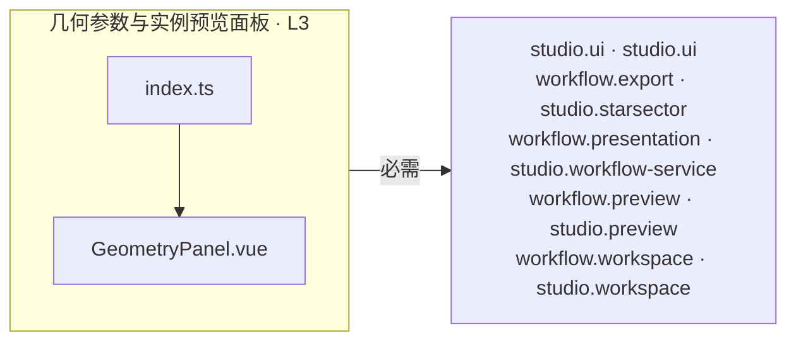

### GLSL 编译后端 · studio.glsl

目录：[glsl-backend/manifest.mjs](../plugins/glsl-backend/manifest.mjs)。实现：[emitter.mjs](../plugins/glsl-backend/emitter.mjs)、[index.mjs](../plugins/glsl-backend/index.mjs)。

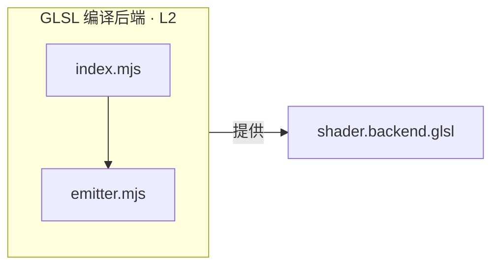

### 画布选择、显示顺序与布局策略 · studio.interaction

目录：[interaction/manifest.mjs](../plugins/interaction/manifest.mjs)。实现：[index.mjs](../plugins/interaction/index.mjs)、[registry.mjs](../plugins/interaction/registry.mjs)。

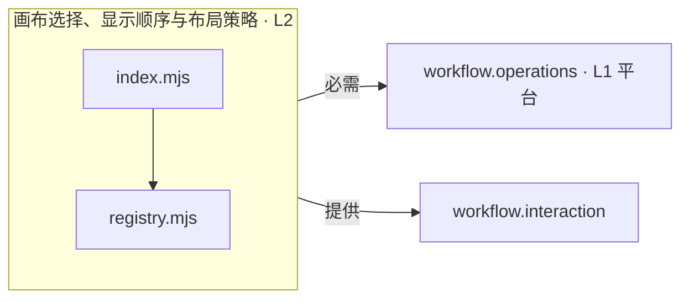

### 工作流自动布局 · studio.layout

目录：[layout/manifest.mjs](../plugins/layout/manifest.mjs)。实现：[index.mjs](../plugins/layout/index.mjs)、[plan.mjs](../plugins/layout/plan.mjs)。

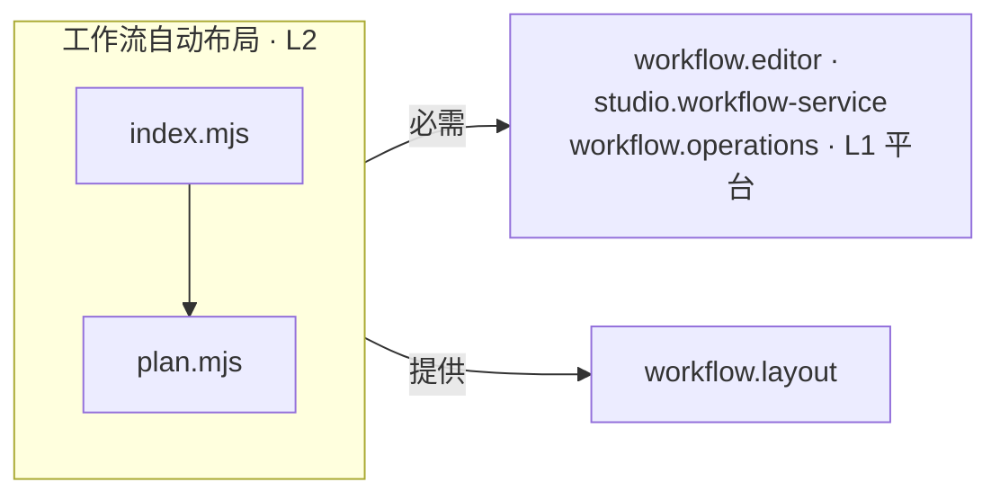

### Math 数学与向量 · studio.math

目录：[math/manifest.mjs](../plugins/math/manifest.mjs)。实现：[contribution.mjs](../plugins/math/contribution.mjs)、[expressions.mjs](../plugins/math/expressions.mjs)、[index.mjs](../plugins/math/index.mjs)、[nodes.mjs](../plugins/math/nodes.mjs)。


### MCP 工作流接入 · studio.mcp

目录：[mcp/manifest.mjs](../plugins/mcp/manifest.mjs)。实现：[McpSettings.vue](../plugins/mcp/McpSettings.vue)、[access-policy.mjs](../plugins/mcp/access-policy.mjs)、[bridge-service.mjs](../plugins/mcp/bridge-service.mjs)、[browser-plugin.ts](../plugins/mcp/browser-plugin.ts)、[self-test.cjs](../plugins/mcp/self-test.cjs)、[server-plugin.mjs](../plugins/mcp/server-plugin.mjs)、[stdio.mjs](../plugins/mcp/stdio.mjs)、[tool-service.mjs](../plugins/mcp/tool-service.mjs)。

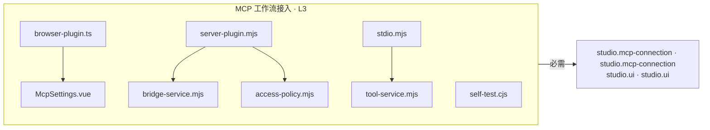

依赖框对应桌面视图的声明。服务端入口使用同一插件 ID 的独立 L2 声明，消费 L1 的 platform.http。stdio.mjs 在 AI 客户端进程中接收工具调用。

### MCP 连接与草稿会话 · studio.mcp-connection

目录：[mcp-connection/manifest.mjs](../plugins/mcp-connection/manifest.mjs)。实现：[connection-guide.mjs](../plugins/mcp-connection/connection-guide.mjs)、[editor-client.mjs](../plugins/mcp-connection/editor-client.mjs)、[index.ts](../plugins/mcp-connection/index.ts)、[session.ts](../plugins/mcp-connection/session.ts)。

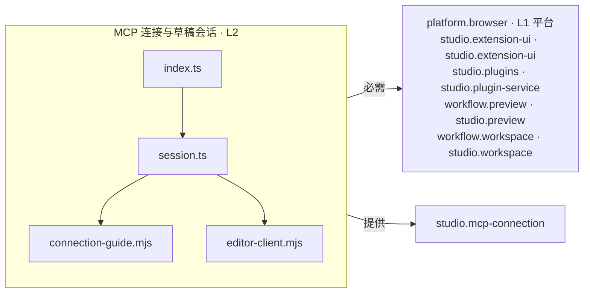

### 节点目录与图语义能力 · studio.node-model

目录：[node-model/manifest.mjs](../plugins/node-model/manifest.mjs)。实现：[graph-snapshot.mjs](../plugins/node-model/graph-snapshot.mjs)、[index.mjs](../plugins/node-model/index.mjs)、[node-catalog.mjs](../plugins/node-model/node-catalog.mjs)、[service.mjs](../plugins/node-model/service.mjs)。

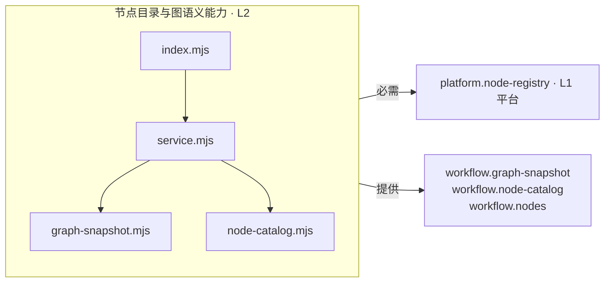

### Noise 噪声节点 · studio.noise

目录：[noise/manifest.mjs](../plugins/noise/manifest.mjs)。实现：[contribution.mjs](../plugins/noise/contribution.mjs)、[expressions.mjs](../plugins/noise/expressions.mjs)、[index.mjs](../plugins/noise/index.mjs)、[nodes.mjs](../plugins/noise/nodes.mjs)。

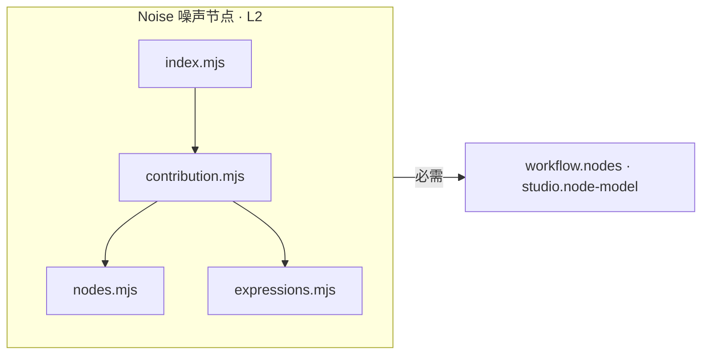

### 插件管理 · studio.plugin-manager

目录：[plugin-manager/manifest.mjs](../plugins/plugin-manager/manifest.mjs)。实现：[DeclarationEditor.vue](../plugins/plugin-manager/DeclarationEditor.vue)、[PluginImpactDialog.vue](../plugins/plugin-manager/PluginImpactDialog.vue)、[PluginManagerPanel.vue](../plugins/plugin-manager/PluginManagerPanel.vue)、[declaration-layout.mjs](../plugins/plugin-manager/declaration-layout.mjs)、[index.ts](../plugins/plugin-manager/index.ts)。

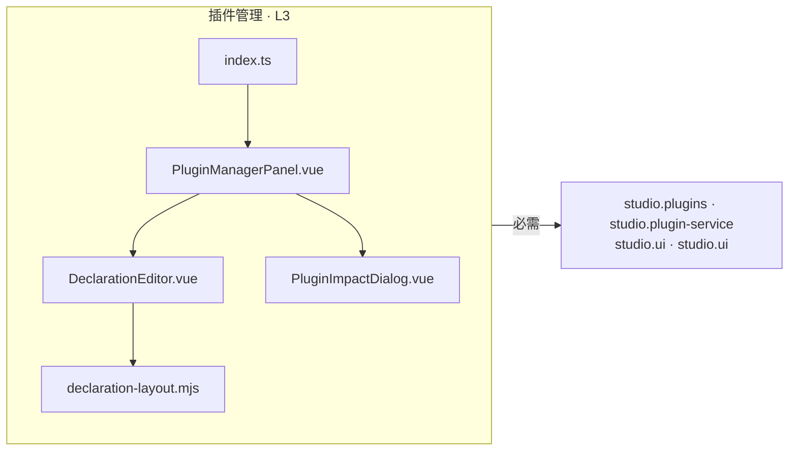

### 插件安装与管理能力 · studio.plugin-service

目录：[plugin-service/manifest.mjs](../plugins/plugin-service/manifest.mjs)。实现：[coordination.mjs](../plugins/plugin-service/coordination.mjs)、[index.mjs](../plugins/plugin-service/index.mjs)、[management.mjs](../plugins/plugin-service/management.mjs)。

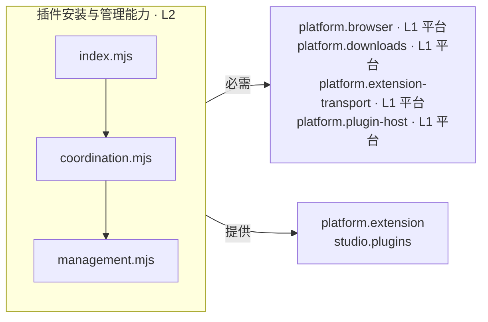

### GPU 预览与高清视框 · studio.preview

目录：[preview/manifest.mjs](../plugins/preview/manifest.mjs)。实现：[PreviewViewer.vue](../plugins/preview/PreviewViewer.vue)、[controller.mjs](../plugins/preview/controller.mjs)、[index.ts](../plugins/preview/index.ts)、[parameters.mjs](../plugins/preview/parameters.mjs)、[playback.mjs](../plugins/preview/playback.mjs)、[renderer.mjs](../plugins/preview/renderer.mjs)、[service.mjs](../plugins/preview/service.mjs)、[view-transform.mjs](../plugins/preview/view-transform.mjs)。

```mermaid
flowchart LR
  subgraph P["GPU 预览与高清视框 · L2"]
    F0["PreviewViewer.vue"]
    F1["controller.mjs"]
    F2["index.ts"]
    F3["parameters.mjs"]
    F4["playback.mjs"]
    F5["renderer.mjs"]
    F6["service.mjs"]
    F7["view-transform.mjs"]
    F0 --> F7
    F1 --> F4
    F2 --> F6
    F2 --> F5
    F2 --> F1
    F2 --> F0
    F5 --> F3
  end
  R["studio.shortcuts · studio.shortcuts<br/>studio.ui · studio.ui<br/>workflow.compilation · studio.compiler<br/>workflow.editor · studio.workflow-service"]
  P -->|必需| R
  P -->|提供| A["workflow.preview"]
```

### 工作流存储与恢复 · studio.project-files

目录：[project-files/manifest.mjs](../plugins/project-files/manifest.mjs)。实现：[index.mjs](../plugins/project-files/index.mjs)、[service.mjs](../plugins/project-files/service.mjs)。

```mermaid
flowchart LR
  subgraph P["工作流存储与恢复 · L2"]
    F0["index.mjs"]
    F1["service.mjs"]
    F0 --> F1
  end
  R["platform.project-files · L1 平台<br/>platform.workflow-file-picker · L1 平台<br/>workflow.editor · studio.workflow-service<br/>workflow.library · studio.workflow-service<br/>workflow.operations · L1 平台"]
  P -->|必需| R
  P -->|提供| A["workflow.file-selection<br/>workflow.project-files"]
```

### 工作流与运行依赖界面 · studio.project-ui

目录：[project-ui/manifest.mjs](../plugins/project-ui/manifest.mjs)。实现：[ProjectActions.vue](../plugins/project-ui/ProjectActions.vue)、[ProjectDialogs.vue](../plugins/project-ui/ProjectDialogs.vue)、[ProjectLibrary.vue](../plugins/project-ui/ProjectLibrary.vue)、[ProjectSettings.vue](../plugins/project-ui/ProjectSettings.vue)、[WorkflowStorage.vue](../plugins/project-ui/WorkflowStorage.vue)、[index.ts](../plugins/project-ui/index.ts)、[session.mjs](../plugins/project-ui/session.mjs)。

```mermaid
flowchart LR
  subgraph P["工作流与运行依赖界面 · L3"]
    F0["ProjectActions.vue"]
    F1["ProjectDialogs.vue"]
    F2["ProjectLibrary.vue"]
    F3["ProjectSettings.vue"]
    F4["WorkflowStorage.vue"]
    F5["index.ts"]
    F6["session.mjs"]
    F3 --> F4
    F3 --> F6
    F5 --> F6
    F5 --> F3
    F5 --> F2
    F5 --> F0
    F5 --> F1
  end
  R["studio.shortcuts · studio.shortcuts<br/>studio.ui · studio.ui<br/>workflow.export · studio.starsector<br/>workflow.file-selection · studio.project-files<br/>workflow.presentation · studio.workflow-service<br/>workflow.project-files · studio.project-files<br/>workflow.templates · studio.templates<br/>workflow.workspace · studio.workspace"]
  P -->|必需| R
```

### SDF 距离与形状 · studio.sdf

目录：[sdf/manifest.mjs](../plugins/sdf/manifest.mjs)。实现：[contribution.mjs](../plugins/sdf/contribution.mjs)、[expressions.mjs](../plugins/sdf/expressions.mjs)、[index.mjs](../plugins/sdf/index.mjs)、[nodes.mjs](../plugins/sdf/nodes.mjs)。

```mermaid
flowchart LR
  subgraph P["SDF 距离与形状 · L2"]
    F0["contribution.mjs"]
    F1["expressions.mjs"]
    F2["index.mjs"]
    F3["nodes.mjs"]
    F0 --> F3
    F0 --> F1
    F2 --> F0
  end
  R["workflow.nodes · studio.node-model"]
  P -->|必需| R
```

### 快捷键配置 · studio.shortcuts

目录：[shortcuts/manifest.mjs](../plugins/shortcuts/manifest.mjs)。实现：[ShortcutSettings.vue](../plugins/shortcuts/ShortcutSettings.vue)、[index.ts](../plugins/shortcuts/index.ts)、[registry.mjs](../plugins/shortcuts/registry.mjs)。

```mermaid
flowchart LR
  subgraph P["快捷键配置 · L2"]
    F0["ShortcutSettings.vue"]
    F1["index.ts"]
    F2["registry.mjs"]
    F1 --> F2
    F1 --> F0
  end
  R["platform.browser · L1 平台<br/>studio.ui · studio.ui"]
  P -->|必需| R
  P -->|提供| A["studio.shortcuts"]
```

### Starsector 特效导出 · studio.starsector

目录：[starsector/manifest.mjs](../plugins/starsector/manifest.mjs)。实现：[configuration.mjs](../plugins/starsector/configuration.mjs)、[export-service.mjs](../plugins/starsector/export-service.mjs)、[history.mjs](../plugins/starsector/history.mjs)、[index.mjs](../plugins/starsector/index.mjs)、[java-material.mjs](../plugins/starsector/java-material.mjs)、[runtime-exporter.mjs](../plugins/starsector/runtime-exporter.mjs)、[session.mjs](../plugins/starsector/session.mjs)。

```mermaid
flowchart LR
  subgraph P["Starsector 特效导出 · L2"]
    F0["configuration.mjs"]
    F1["export-service.mjs"]
    F2["history.mjs"]
    F3["index.mjs"]
    F4["java-material.mjs"]
    F5["runtime-exporter.mjs"]
    F6["session.mjs"]
    F1 --> F5
    F1 --> F0
    F1 --> F4
    F3 --> F6
    F3 --> F2
    F3 --> F1
    F5 --> F4
  end
  R["platform.assets · L1 平台<br/>platform.downloads · L1 平台<br/>platform.export-storage · L1 平台<br/>shader.backend.glsl · studio.glsl<br/>workflow.compilation · studio.compiler<br/>workflow.editor · studio.workflow-service<br/>workflow.operations · L1 平台<br/>workflow.project-files · studio.project-files"]
  P -->|必需| R
  P -->|提供| A["workflow.export"]
```

导出的游戏特效共用 [WorkflowRuntime.java](../plugins/starsector/runtime/WorkflowRuntime.java)，该文件不在编辑器进程中执行。

### 工作流模板与示例 · studio.templates

目录：[templates/manifest.mjs](../plugins/templates/manifest.mjs)。实现：[examples.mjs](../plugins/templates/examples.mjs)、[index.mjs](../plugins/templates/index.mjs)、[presets.mjs](../plugins/templates/presets.mjs)。

```mermaid
flowchart LR
  subgraph P["工作流模板与示例 · L2"]
    F0["examples.mjs"]
    F1["index.mjs"]
    F2["presets.mjs"]
    F1 --> F2
    F1 --> F0
  end
  R["workflow.editor · studio.workflow-service<br/>workflow.operations · L1 平台<br/>workflow.template-storage · L1 平台"]
  P -->|必需| R
  P -->|提供| A["workflow.templates"]
```

### 基础 UI 与工作区组件 · studio.ui

目录：[ui/manifest.mjs](../plugins/ui/manifest.mjs)。实现：[ComponentWorkshop.vue](../plugins/ui/ComponentWorkshop.vue)、[WaveControls.vue](../plugins/ui/WaveControls.vue)、[index.ts](../plugins/ui/index.ts)、[service.ts](../plugins/ui/service.ts)、[workspace-registry.ts](../plugins/ui/workspace-registry.ts)。

```mermaid
flowchart LR
  subgraph P["基础 UI 与工作区组件 · L2"]
    F0["ComponentWorkshop.vue"]
    F1["WaveControls.vue"]
    F2["index.ts"]
    F3["service.ts"]
    F4["workspace-registry.ts"]
    F0 --> F1
    F2 --> F3
    F2 --> F0
    F3 --> F4
  end
  R["platform.ui-shell · L1 平台"]
  P -->|必需| R
  P -->|提供| A["studio.ui"]
```

### 工作流编辑与检查器能力 · studio.workflow-service

目录：[workflow-service/manifest.mjs](../plugins/workflow-service/manifest.mjs)。实现：[application.mjs](../plugins/workflow-service/application.mjs)、[descriptions.mjs](../plugins/workflow-service/descriptions.mjs)、[document-policy.mjs](../plugins/workflow-service/document-policy.mjs)、[document-session.mjs](../plugins/workflow-service/document-session.mjs)、[editor-session.mjs](../plugins/workflow-service/editor-session.mjs)、[index.mjs](../plugins/workflow-service/index.mjs)、[presentation.mjs](../plugins/workflow-service/presentation.mjs)、[service.mjs](../plugins/workflow-service/service.mjs)。

```mermaid
flowchart LR
  subgraph P["工作流编辑与检查器能力 · L2"]
    F0["application.mjs"]
    F1["descriptions.mjs"]
    F2["document-policy.mjs"]
    F3["document-session.mjs"]
    F4["editor-session.mjs"]
    F5["index.mjs"]
    F6["presentation.mjs"]
    F7["service.mjs"]
    F0 --> F4
    F0 --> F2
    F0 --> F3
    F5 --> F7
    F5 --> F6
    F5 --> F1
    F5 --> F0
  end
  R["platform.workspace-state · L1 平台<br/>workflow.node-catalog · studio.node-model"]
  P -->|必需| R
  P -->|提供| A["workflow.editor<br/>workflow.library<br/>workflow.presentation"]
```

### 工作流视图与检查器 · studio.workflow-ui

目录：[workflow-ui/manifest.mjs](../plugins/workflow-ui/manifest.mjs)。实现：[CanvasTools.vue](../plugins/workflow-ui/CanvasTools.vue)、[CustomNodeEditor.vue](../plugins/workflow-ui/CustomNodeEditor.vue)、[GraphEditor.vue](../plugins/workflow-ui/GraphEditor.vue)、[Inspector.vue](../plugins/workflow-ui/Inspector.vue)、[InspectorField.vue](../plugins/workflow-ui/InspectorField.vue)、[NodeCard.vue](../plugins/workflow-ui/NodeCard.vue)、[NodeCatalog.vue](../plugins/workflow-ui/NodeCatalog.vue)、[NodeIdentity.vue](../plugins/workflow-ui/NodeIdentity.vue)、[PortView.vue](../plugins/workflow-ui/PortView.vue)、[PreviewControls.vue](../plugins/workflow-ui/PreviewControls.vue)、[PreviewSurface.vue](../plugins/workflow-ui/PreviewSurface.vue)、[TimeValue.vue](../plugins/workflow-ui/TimeValue.vue)、[WorkspaceControls.vue](../plugins/workflow-ui/WorkspaceControls.vue)、[gestures.ts](../plugins/workflow-ui/gestures.ts)、[index.ts](../plugins/workflow-ui/index.ts)、[keyboard.ts](../plugins/workflow-ui/keyboard.ts)、[session.mjs](../plugins/workflow-ui/session.mjs)、[shortcuts.mjs](../plugins/workflow-ui/shortcuts.mjs)。

```mermaid
flowchart LR
  subgraph P["工作流视图与检查器 · L3"]
    F0["CanvasTools.vue"]
    F1["CustomNodeEditor.vue"]
    F2["GraphEditor.vue"]
    F3["Inspector.vue"]
    F4["InspectorField.vue"]
    F5["NodeCard.vue"]
    F6["NodeCatalog.vue"]
    F7["NodeIdentity.vue"]
    F8["PortView.vue"]
    F9["PreviewControls.vue"]
    F10["PreviewSurface.vue"]
    F11["TimeValue.vue"]
    F12["WorkspaceControls.vue"]
    F13["gestures.ts"]
    F14["index.ts"]
    F15["keyboard.ts"]
    F16["session.mjs"]
    F17["shortcuts.mjs"]
    F2 --> F13
    F2 --> F15
    F2 --> F11
    F2 --> F10
    F3 --> F1
    F3 --> F7
    F14 --> F0
    F14 --> F17
    F14 --> F16
    F14 --> F5
    F14 --> F8
    F14 --> F4
    F14 --> F11
    F14 --> F2
    F14 --> F3
    F14 --> F6
    F14 --> F9
    F14 --> F12
  end
  R["studio.shortcuts · studio.shortcuts<br/>studio.ui · studio.ui<br/>workflow.interaction · studio.interaction<br/>workflow.preview · studio.preview<br/>workflow.workspace · studio.workspace"]
  P -->|必需| R
```

### 工作区操作与会话 · studio.workspace

目录：[workspace/manifest.mjs](../plugins/workspace/manifest.mjs)。实现：[index.mjs](../plugins/workspace/index.mjs)、[service.mjs](../plugins/workspace/service.mjs)。

```mermaid
flowchart LR
  subgraph P["工作区操作与会话 · L2"]
    F0["index.mjs"]
    F1["service.mjs"]
    F0 --> F1
  end
  R["platform.browser · L1 平台<br/>platform.workspace-execution · L1 平台<br/>workflow.editor · studio.workflow-service<br/>workflow.operations · L1 平台"]
  P -->|必需| R
  O["workflow.export · studio.starsector<br/>workflow.layout · studio.layout<br/>workflow.project-files · studio.project-files<br/>workflow.templates · studio.templates"]
  P -.->|可选| O
  P -->|提供| A["workflow.workspace"]
```
